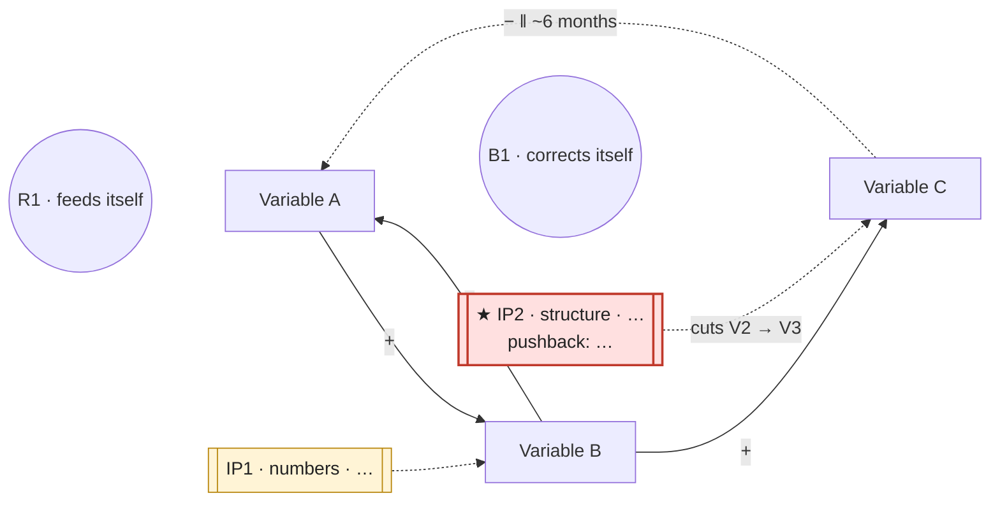

# systems-loop — one phenomenon in, a causal loop with three intervention points out

**One line:** a social problem that comes back after the fix was a symptom, not the problem. The AI lists what has been tried and the links; the human sorts, checks signs, counts loops and chooses where to push.

**Built from 3 prompts:** `prompts/12`, `prompts/13`, `prompts/14` (optional). Source: Guide 4, steps 1–9.

```
phenomenon → 1 problem → 2 eight tries → 3 ladder → 4 one step up
           → 5 variables → 6 ten links → 7 signs vs facts → 8 two loops + delay
           → 9 three intervention points → diagram
```

| Step | Move | Who | You get |
|---|---|---|---|
| 1 | Problem as people say it | human | one "How can we" sentence |
| 2 | Intervention lister | AI, fresh agent, `prompts/12` | eight interventions, each labelled |
| 3 | Sort on the ladder | human | each on a step, at least two labels corrected |
| 4 | One step up | human | one line for the step above, and who pushes back |
| 5 | Variables | human | five to eight nouns that go up or down |
| 6 | Link lister | AI, fresh agent, `prompts/13` | ten links with signs |
| 7 | Check the signs | human | about five links, each with a fact |
| 8 | Loops and delay | human | two loops marked R or B, one delay |
| 9 | Three intervention points | human (`prompts/14` may draft) | three points on three steps, the strongest named |

**The ladder** (weakest → strongest): **numbers** → **rules** → **information** (who can see what) → **structure** (who is connected to whom) → **goals** (what the whole system is for).

## Steps

### 1 · Write the problem the way people say it (human)

Turn the phenomenon into one sentence, as the people who complain about it say it, starting with "How can we".
**Checkpoint:** the problem is the right size: a town, a campus, a street, a service. "Climate change" is too big; "the recycling truck comes when working people are not home" is right. If the sentence already contains a solution ("How can we build more shelters"), write it again without it. In autopilot, if the phenomenon is too big, narrow it to one place yourself and mark the choice `[AI judged]`.

### 2 · List what has been tried (AI) — fresh agent

Run `prompts/12-intervention-lister.md` with the step 1 sentence.
**Checkpoint:** eight lines, at least three voices, each with a label at the end, no recommendation. If it recommended, reply *No solutions. Only the list.* and run again. Keep the labels; step 3 corrects them.

### 3 · Sort the eight on the ladder (human — the AI labels by how a proposal sounds, not by what it changes)

Put each line on one of the five steps. Do not trust the AI's labels.
**Checkpoint:** every line has a step, and for at least two of them you wrote whether the AI's label was right or wrong, and why. The test for a doubtful line: say it without the money or the quantity; if nothing is left, it is a number. Count how many sit on the bottom two steps; most should.

### 4 · Name one step up and who pushes back (human)

Find the highest step any of the eight reaches. Write one line for the step above it, and one line naming who would push back.
**Checkpoint:** the step up changes a different kind of thing, not a bigger amount of the same. You can name a person or an office that would object. If nobody would object, you have written a bigger number; try again.

### 5 · List the variables (human — write them before the AI does, so you can catch its adjectives)

Five to eight variables: nouns that can go up or down. Also write three or four facts about the problem for step 6.
**Checkpoint:** put "more" in front of each; it still makes sense. "Dogs on the street" passes; "people are irresponsible" does not. Each is something somebody could count at one moment.

### 6 · List the links (AI) — fresh agent

Run `prompts/13-link-lister.md` with the step 1 problem, the facts and the variables.
**Checkpoint:** ten lines in the `A → B, sign` form, no explanations, no solutions. If it explained, reply *No explanations. Only A → B and the sign.* If it added variables, check them with the "more" test (*Each variable must be a noun I could count. Rewrite them.*). Expect some signs to be guessed; that is what step 7 is for.

### 7 · Check every sign against a fact (human — the AI will defend its own arrows, so do not ask it)

Next to each link, write the fact that gives it its sign, or cross the link out.
**Checkpoint:** every kept link has a fact beside it: something seen, read or counted, in a few words. About half of the ten survive; ten survivors means you did not check. A sign is a direction, not a judgement.
In autopilot: never invent a number, a date or a source. A fact the AI only believes is written as `(to check: …)` and marked `[AI judged]`.

### 8 · Find two loops and one delay (human — the first of the things that are yours)

Follow the kept links back to where they start. For each loop write the variables in order, count the minus signs, mark **R** (even: feeds itself) or **B** (odd: corrects itself). Mark one delay with `‖` and a rough time.
**Checkpoint:** two loops, each written in order with its count. At least one is B, the system's thermostat; if you cannot find one, ask where the system pushes back (complaints, cost, space) and follow that arrow home, adding a link back in step 6–7 if needed. One arrow carries `‖` with a rough time. You can say which loop currently wins and point at a fact.

### 9 · Choose three intervention points on three steps (human — the second thing that is yours)

For each of three different ladder steps, write the **address** on the loop (the variable you push, the arrow you cut, the path you add) and one line on what it changes. Mark the strongest ★ and name who pushes back.
If you want ideas for a step you have already chosen, run `prompts/14-intervention-drafter.md` as a fresh agent for that step only. It drafts; it does not choose.
**Checkpoint:** three steps, all different; three numbers is one point three times. Each point has an address on the loop, not a slogan. The strongest has a reason and a named opponent; "nobody" means you chose a number. Step 4's step-up line is a good candidate for one of the three.

### 10 · Draw the diagram (AI, from the kept material only)

Draw one Mermaid `flowchart LR` from the **kept** links of step 7, the loops and delay of step 8, and the points of step 9. Nothing crossed out goes in. Use these conventions:

- each variable is a node `V1["Variable name"]`;
- each kept link is `A -->|"+"| B` or `A -->|"−"| B`;
- the delay arrow is dotted and carries its time: `A -.->|"− ‖ ~6 months"| B`;
- each loop gets a round label node, `R1(("R1 · feeds itself"))` or `B1(("B1 · corrects itself"))`, linked with `~~~` to one variable in that loop;
- each intervention point is a node `IP1[["IP1 · step · what it changes"]]` with class `ip`; the strongest also has class `strong`, a ★ and `pushback: …`;
  - **push a variable:** `IP1 -.-> V3`;
  - **cut an arrow:** `IP2 -.->|"cuts V2 → V4"| V4`;
  - **add a path:** draw the new link thick, `V5 ==>|"+ new path (IP3)"| V1`, and `IP3 -.-> V5`.



**Checkpoint:** every arrow in the diagram is a kept link from step 7 (or a path added in step 9, drawn thick); both loops can be traced on it; the delay is visible; every intervention point touches the diagram at its address. If an IP points at nothing, go back to step 9.

## Output

In autopilot, print each step briefly as it runs (`Step N · …`), then end with this, **diagram first**:

```
## Causal loop: <short name>

<the Mermaid diagram>

Problem:          How can we …
Ladder (step 3):  numbers n · rules n · information n · structure n · goals n   (AI labels corrected: …)
Step up (step 4): … — pushback: …
Loops (step 8):   R1: A → B → A (0 minus) · B1: A → C → A (1 minus); currently winning: … because …
Delay:            X → Y ‖ ~…
Intervention points (step 9):
  IP1 · <step> · <address> · changes …
  IP2 · <step> · <address> · changes …
  ★ IP3 · <step> · <address> · changes … · strongest because … · pushback: …
Crossed out (step 7): A → B (no fact) · …

Rewrite these yourself:
- … [AI judged]
```

Then save the record as `runs/YYYY-MM-DD-loop-<short-name>.md` (every step's output, what was crossed out and why, every `[AI judged]` sentence, and the diagram), commit that one file and push it to the current branch, as `CLAUDE.md` asks for a full run.

## Always yours

The signs and the R/B count (step 8) and the choice of the strongest point (step 9) are never really written by the AI. In autopilot it drafts them, marks each `[AI judged]`, and lists them under **Rewrite these yourself**, together with every step 7 fact it could not point to.

## Watch out

- **Solutions too early.** Steps 2 and 6 forbid them; at any step, reply *No solutions. Only the list.* (or *the links*).
- **Adjectives as variables.** "Awareness is low" is not a variable; "people who know the pickup time" is.
- **Ten kept links.** That means nothing was checked.
- **Three numbers.** Three subsidies of different sizes are one intervention point three times.
- **In autopilot the lister and the judge are the same model.** Step 7 loses its point when the AI checks its own arrows. Treat an autopilot diagram as a draft to take to someone who knows the place.

## Hands on

The strongest point's pushback (step 9) is a ready-made objection for `/triz`. A loop that keeps winning although everyone hates it often hides an assumption for `/hidden-assumption`.
