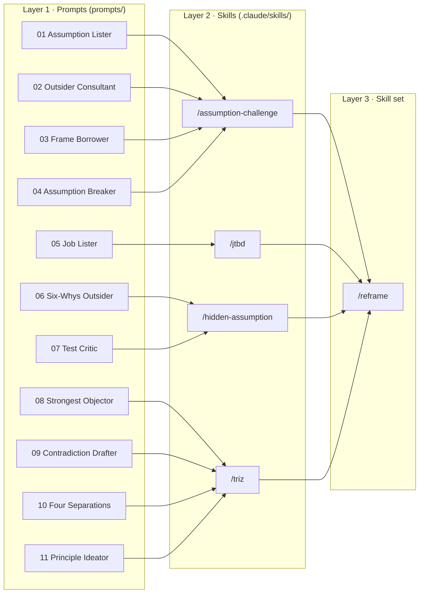

# From prompts to a skill set

Last week you typed eleven prompts, one by one, into new chats. This repo packs the same eleven prompts into four **skills**, then chains those four skills into one **skill set**. You ask one question; the skill set runs the rest.



## The three layers

| Layer | What it is | What it adds | Where |
|---|---|---|---|
| **Prompt** | One instruction for one role | A role and a lock ("No solutions.") | [`prompts/`](prompts/) |
| **Skill** | Several prompts in order | The order, a **checkpoint** after each step, and the steps a human must do | [`.claude/skills/<name>/SKILL.md`](.claude/skills/) |
| **Skill set** | Several skills in a chain | Which skills to run, and how the output of one becomes the input of the next | [`.claude/skills/reframe/SKILL.md`](.claude/skills/reframe/SKILL.md) |
| **House rules** | Rules every skill shares | Autopilot vs coach mode, the `[AI judged]` mark | [`CLAUDE.md`](CLAUDE.md) |

Open any `SKILL.md` and look for "Run `prompts/…`". That line is where a prompt becomes part of a skill.

## Try it

1. Go to **claude.ai/code** and open this repo.
2. Type one line:

   ```
   /reframe How can our department get more students to come to office hours?
   ```

3. Watch it run four stages. Each stage prints `Stage N · /skill-name · input: …` so you can see the hand-off.

When it finishes, the full record is pushed to a new branch under [`runs/`](runs/). A finished example is already there: [`runs/sample-office-hours.md`](runs/sample-office-hours.md).

Want to make every decision yourself? Add **"coach me"**. It stops at each human step and waits.

Want just one skill? Type `/jtbd`, `/triz`, `/assumption-challenge` or `/hidden-assumption` on its own.

## Read the end first

The run ends with a list called **Rewrite these yourself**. Every line there carries `[AI judged]`: the AI made a call that only someone who knows the place can make. Three sentences always belong to you: the hidden-assumption sentence, the P-and-not-P sentence, and the one-week test.

A skill set can carry you from a question to an idea in one go. It cannot know which of its "facts" are true where you live.
