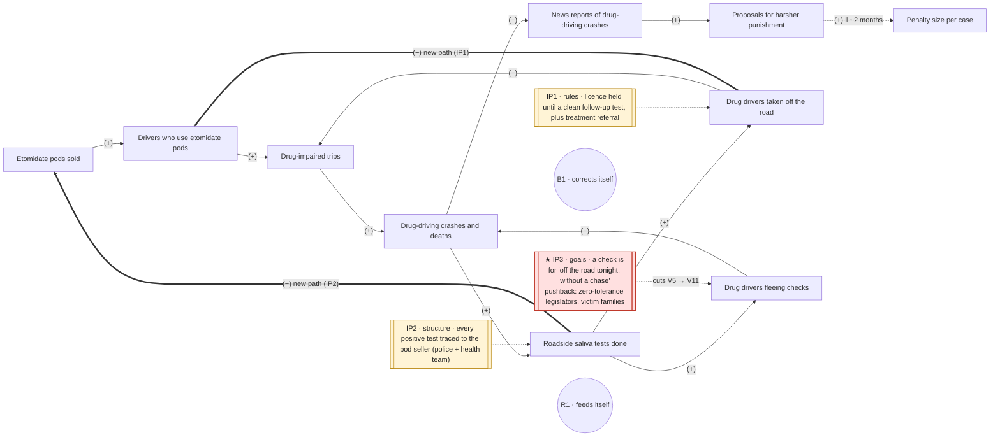

# 2026-10-12 · loop · drug driving

Skill: `/systems-loop` (fully automatic, no human steps).
Input: "台灣有許多人吸毒後開車, 造成許多意外車禍與無辜死亡" (Many people in Taiwan drive after taking drugs, causing many crashes and innocent deaths.)
Facts come from Central News Agency (CNA) reports; sources at the end.

## Causal loop: drug driving in New Taipei



```
Problem:          How can we stop drivers who have taken drugs (often "zombie" etomidate vape pods) from crashing into people on New Taipei's roads?
Ladder (step 3):  numbers 1 · rules 3 · information 3 · structure 1 · goals 0   (labels corrected: #5 structure → information; #7 goals → structure)
Step up (step 4): goals: judge the system by drug-impaired trips prevented before the crash, not by cases filed and sentences raised after it
                  — pushback: zero-tolerance legislators (death-penalty proposal, May 2026), police performance points that count cases
Loops (step 8):   B1: crashes → saliva tests → drivers off the road → impaired trips → crashes (1 minus)
                  R1: crashes → saliva tests → drivers fleeing checks → crashes (0 minus)
                  currently winning: B1, because the crash rate fell 23% during the 2026 special operation [12]; R1 shows in the deadliest cases [6][7]
Delay:            proposals for harsher punishment → penalty size ‖ ~2 months (Zhonghe crash 23 May → law passed 28 July 2026)
Intervention points (step 9):
  IP1 · rules     · adds path drivers off the road → drivers who use pods (−) · changes a caught driver from "punished" to "punished and treated"
  IP2 · structure · adds path saliva tests → pods sold (−) · links the roadside check to the supply chain
  ★ IP3 · goals   · cuts saliva tests → drivers fleeing checks · changes what a check is for: plates recorded, no high-speed chase, penalty by summons
          strongest because it is the only point that weakens R1, the loop that turns every new checkpoint into a chase, and it sits at the top of the ladder
          pushback: zero-tolerance legislators and candidates (death-penalty and flogging proposals), victim families asking for the heaviest sentence
Crossed out (step 7): tests → perceived chance of being caught · perceived chance → impaired trips · treatment → pod users · proposals → saliva tests · penalty size → fleeing checks
Facts to check:   (to check: number of saliva tests done before and after the proposals) · (to check: survey of drivers' perceived chance of being caught)
                  (to check: impaired-trip or positive-test rate over time) · (to check: treatment numbers and whether treated users stop driving on pods)
                  (to check: count of drivers fleeing checks before and after the Nov 2025 and July 2026 penalty rises)
```

**What the diagram shows:** penalty size (V6), the thing most of the 2026 response pushed, has no kept arrow leading back into either loop. No fact showed that heavier penalties reduce impaired trips or increase flight. It is a dead end on the diagram, not yet a lever.

---

## Step 1 · Problem as people say it

Phenomenon: all of Taiwan, too big. Narrowed to **New Taipei**, where the deadly etomidate crash in Zhonghe (23 May 2026) happened [2].

> How can we stop drivers who have taken drugs (often "zombie" etomidate vape pods) from crashing into people on New Taipei's roads?

Checkpoint ✓: one city, no solution in the sentence.

## Step 2 · Intervention lister (fresh agent, `prompts/12`)

1. (Legislator) Move etomidate up the drug schedule so possessing and using pods brings heavier criminal penalties, not just fines and lectures. Changes: a rule.
2. (Police officer) Give traffic police roadside saliva drug-test kits so they can screen drivers at checkpoints the way they already breath-test for alcohol. Changes: who can see what.
3. (Ministry of Justice official) Raise prison terms and fines under Criminal Code Article 185-3 for driving under drugs, and treat a crash that kills someone like drunk-driving homicide. Changes: a number.
4. (Motor vehicles office) Suspend or cancel the licence of anyone caught drug-driving, and make them finish drug-awareness classes before they can apply again. Changes: a rule.
5. (Customs and FDA official) Test imported e-cigarette pods and seize shipments with etomidate, and trace the people who send and receive them. Changes: who is connected to whom.
6. (Parent / citizen) Report suspicious vape-pod sellers on social media and in school chat groups to a police tip line, with rewards for tips that lead to arrests. Changes: who can see what.
7. (Anti-drug NGO worker) Run outreach and treatment for young users so the aim moves from punishing users to getting them off the drug before they drive. Changes: what the whole system is for.
8. (Delivery or ride-hailing company manager) Run random drug tests on drivers and riders, and drop anyone who fails from the platform. Changes: a rule.

Checkpoint ✓: eight lines, eight voices, labelled, no ranking.

## Step 3 · Sort on the ladder

| # | Lister's label | Sorted to | Lister right? |
|---|---|---|---|
| 1 | rule | rules | ✓ |
| 2 | who can see what | information | ✓ |
| 3 | number | numbers | ✓ |
| 4 | rule | rules | ✓ |
| 5 | who is connected | **information** | ✗ Tracing a supply chain makes it visible; it does not connect anyone new |
| 6 | who can see what | information | ✓ (the reward part is a number) |
| 7 | what the system is for | **structure** | ✗ It links users to treatment; road safety's goal (punish after the crash) stays the same |
| 8 | rule | rules | ✓ |

Count: numbers 1 · rules 3 · information 3 · structure 1 · goals 0. Four of eight on the bottom two steps. The real 2026 response sat there too: higher fines, licence revoked, car confiscated [3][4][5], death penalty proposed [11].

## Step 4 · One step up

Highest step reached: structure. Step above, goals:
> The system is judged by drug-impaired trips prevented before the crash, not by cases filed and sentences raised after it.

Pushback: legislators running on "zero tolerance, harsher penalties" (the KMT caucus death-penalty proposal, May 2026 [11]), and police performance points that count arrests.

## Step 5 · Variables and facts

Variables: drivers who use etomidate pods · drug-impaired trips · drug-driving crashes and deaths · news reports of drug-driving crashes · roadside saliva tests done · penalty size per case · etomidate pods sold · users in treatment. All pass the "more" test.

Facts:
1. Roadside saliva rapid tests became enforceable nationwide on 20 Nov 2025; refusing costs NT$180,000 and the licence [1].
2. After the Zhonghe crash on 23 May 2026 (1 dead, 1 injured), the mayor ordered expanded checkpoints; within days the Ministry of Justice announced heavier penalties and a caucus proposed the death penalty [2][10][11].
3. On 28 July 2026 the Legislature passed amendments: licence revoked and car confiscated for drug driving or refusal; lifetime ban for serious injury or death [3].
4. Etomidate became a Level 3 drug in Aug 2024 and Level 2 in Nov 2024, after a July 2024 New Taipei crash killed a police officer [8]; crashes involving pods kept being reported through 2026 [9].

## Step 6 · Link lister (fresh agent, `prompts/13`)

1. etomidate pods sold → drivers who use etomidate pods, +
2. drivers who use etomidate pods → drug-impaired trips, +
3. drug-impaired trips → drug-driving crashes and deaths, +
4. drug-driving crashes and deaths → news reports of drug-driving crashes, +
5. news reports → public pressure for harsher punishment, +
6. public pressure → penalty size per case, +
7. public pressure → roadside saliva tests done, +
8. roadside saliva tests done → drivers' perceived chance of being caught, +
9. drivers' perceived chance of being caught → drug-impaired trips, −
10. users in treatment → drivers who use etomidate pods, −

Checkpoint ✓: form correct, no explanations. Added variable "public pressure for harsher punishment" fails the "more"/countable test → renamed **proposals for harsher punishment**. "Perceived chance of being caught" passes (countable by survey).

## Step 7 · Check the signs (fresh checker agent)

| # | Link | Verdict | Fact or reason |
|---|---|---|---|
| 1 | pods sold → pod users, + | KEEP | pods smuggled as e-cigarette oil; one seizure ≈ 85,000 pods; most pod users found were drivers [8][9] |
| 2 | pod users → impaired trips, + | KEEP | pod users mostly drivers; drivers caught by saliva tests at stops [9][1] |
| 3 | impaired trips → crashes, + | KEEP | pod crashes in New Taipei 2024, Danshui, Zhonghe, Freeway 3 [8][2] |
| 4 | crashes → news reports, + | KEEP | each crash was reported (observable) |
| 5 | news → proposals, + | KEEP | within three days of Zhonghe: MOJ heavier penalties, death-penalty proposal [10][11] |
| 6 | proposals → penalty size, + | KEEP | amendments passed 28 July 2026 [3] |
| 7 | proposals → saliva tests, + | CROSS | tests began Nov 2025, before the proposals; checkpoints followed the crash, not the proposals (to check: number of saliva tests before/after) |
| 8 | saliva tests → perceived chance, + | CROSS | no fact on what drivers believe (to check: survey) |
| 9 | perceived chance → impaired trips, − | CROSS | no fact shows fewer trips; crashes kept being reported (to check: positive-test rate over time) |
| 10 | treatment → pod users, − | CROSS | no fact mentions treatment (to check: treatment numbers) |

6 of 10 kept.

## Step 8 · Loops and delay — first try failed

The six kept links form one straight chain (pods sold → … → penalty size). Nothing returns, so there is no loop. Per the checkpoint: ask where the system pushes back and follow that arrow home. New CNA facts were gathered and six new links went back through steps 6–7 to a new fresh checker:

New facts:
- A. The day after Zhonghe, New Taipei's mayor ordered more checkpoints [2]; Taipei set up drug/alcohol checkpoints on 1 June 2026 [13].
- B. Positive drivers are arrested, cars held, some detained by court order [14][15].
- C. Drug-driving enforcement cases grew 4.6× (MOTC, 28 May 2026); New Taipei has Taiwan's highest enforcement count [16][17].
- D. A 2026 special operation handled 10,000+ cases; crash rate fell 23% during it [12].
- E. Deadly or injury crashes while drug drivers fled checks: Lukang 3 Apr (1 killed), Kaohsiung 2 May (3 hurt), Zhonghe 23 May, Taoyuan 11 Jun (2 killed), Xinzhuang 24 Aug [6][7][18][19][20].

| # | Link | Verdict | Fact or reason |
|---|---|---|---|
| 11 | crashes → saliva tests done, + | KEEP | A |
| 12 | saliva tests → drivers taken off the road, + | KEEP | B |
| 13 | drivers off the road → impaired trips, − | KEEP | B: a detained driver or held car makes no trips (observable) |
| 14 | saliva tests → drivers fleeing checks, + | KEEP | E: every flight began at a check |
| 15 | drivers fleeing checks → crashes, + | KEEP | E |
| 16 | penalty size → drivers fleeing checks, + | CROSS | no fact shows flight rose with penalties (to check: flight count before/after penalty rises) |

Across both rounds: 11 of 16 kept.

## Step 8 · Loops and delay

- **B1** crashes → saliva tests (+) → drivers off the road (+) → impaired trips (−) → crashes (+). 1 minus → **B**.
- **R1** crashes → saliva tests (+) → drivers fleeing checks (+) → crashes (+). 0 minus → **R**.
- **Delay:** proposals → penalty size ‖ ~2 months (23 May → 28 July 2026).
- **Winning now:** B1. Crash rate −23% during the special operation [12]. R1 shows in the deadliest cases (Taoyuan 2 killed, Lukang 1 killed).

## Step 9 · Three intervention points

Steps chosen: rules, structure, goals (goals = step 4's step up). One fresh `prompts/14` drafter per step.

**Rules drafter:** (1) make refusing or fleeing a test legally the same as testing positive; cuts tests → fleeing. (2) strict seller liability for shops and platforms; cuts pods sold → pod users. (3) a positive test triggers a mandatory treatment referral, licence held until a clean follow-up test; adds path drivers off the road → pod users (−).
**Structure drafter:** (1) trace each positive test to the pod's seller via a joint police and health team; adds path tests → seller investigations → pods sold (−). (2) every positive driver referred straight to the health department's treatment programme; adds path drivers off the road → treatment referrals → pod users (−). (3) plate cameras at checkpoints and a summons for later testing, so fleeing doesn't escape the charge; cuts tests → fleeing.
**Goals drafter:** (1) the target becomes "fewer impaired trips each month", not "cases sent to prosecutors"; adds path impaired trips → tests. (2) the checkpoint's goal becomes "get the impaired driver safely off the road tonight", not "catch and punish"; cuts tests → fleeing. (3) the city's pod goal becomes "fewer people using pods" (public health), not "heavier penalty per case".

Chosen:
- **IP1 · rules** = rules #3. Address: adds path drivers off the road → pod users (−).
- **IP2 · structure** = structure #1. Address: adds path saliva tests → pods sold (−).
- **★ IP3 · goals** = goals #2 with structure #3's mechanism. Address: cuts saliva tests → drivers fleeing checks. Strongest because it is the only point that weakens R1, and it changes what a check is for. Pushback: zero-tolerance legislators and candidates (death-penalty proposal [11], flogging referendum idea [21]); victim families asking for the heaviest sentence [22].

Not chosen: rules #1 (refusal already costs NT$180,000 and the licence [1], and the penalty → fleeing link was crossed out, so it is a bigger number).

Checkpoint ✓: three different steps, each with an address on the loop, the strongest named with a reason and opponents.

## Step 10 · Diagram

See the top of this file. Every arrow is a kept link from step 7, or a path added in step 9 (drawn thick). Both loops, the delay and all three IPs are attached.

## Sources

1. 毒品唾液快篩執法即起上路 拒測重罰18萬並吊照 — 2025-11-20 — https://www.cna.com.tw/news/aall/202511200202.aspx
2. 中和男毒駕釀死傷　侯友宜：毒駕零容忍 — 2026-05-24 — https://www.cna.com.tw/news/aall/202605240115.aspx
3. 道交條例三讀　內政部：杜絕毒駕儘速完成配套執行 — 2026-07-28 — https://www.cna.com.tw/news/aall/202607280287.aspx
4. 政院修法毒駕或拒測一律吊銷駕照、沒入車輛　致重傷死亡終身禁考照 — 2026-06-18 — https://www.cna.com.tw/news/aall/202606180141.aspx
5. 交通部修法毒駕拒測首罰27萬　無照駕駛再加罰3.6萬 — 2026-06-04 — https://www.cna.com.tw/news/aall/202606040096.aspx
6. 桃園男毒駕拒檢　高速逃逸失控撞死2路人 — 2026-06-12 — https://www.cna.com.tw/news/aall/202606120008.aspx
7. 鹿港小貨車拒檢竄逃撞死老婦　彰檢訊後聲押毒駕男 — 2026-04-04 — https://www.cna.com.tw/news/aall/202604040207.aspx
8. 喪屍煙彈氾濫 卓榮泰：依托咪酯最快14日改列二級毒品 — 2024-11-13 — https://www.cna.com.tw/news/aall/202411130233.aspx
9. 喪屍煙彈常搭毒駕 刑事局設全國查緝專案 — 2025-02-20 — https://www.cna.com.tw/news/aall/202502200110.aspx
10. 毒駕零容忍　法務部啟動修法加重處罰、研議沒收車輛 — 2026-05-25 — https://www.cna.com.tw/news/aall/202605250242.aspx
11. 毒駕頻傳　國民黨團研擬修法加重刑責 — 2026-05-26 — https://www.cna.com.tw/news/aall/202605260165.aspx
12. 政院：毒駕專案查緝逾萬件　肇事率減少23% — 2026-10-01 — https://www.cna.com.tw/news/aall/202610010317.aspx
13. 北市員警加強毒酒測攔檢（photo caption） — 2026-06-01 — CNA PhotoTaiwan
14. 北市男毒駕追撞10車幸無人傷　北檢聲請羈押獲准 — 2026-05-28 — https://www.cna.com.tw/news/aall/202605280051.aspx
15. 台中2起車禍波及路旁8汽機車  2人涉毒駕移送法辦 — 2026-08-26 — https://www.cna.com.tw/news/aall/202608260188.aspx
16. 毒駕頻傳　交通部推修法先依高風險換照管理 — 2026-05-28 — https://www.cna.com.tw/news/aall/202605280135.aspx
17. 毒駕氾濫　侯友宜：應強化源頭預防、重懲累犯 — 2026-05-28 — https://www.cna.com.tw/news/aall/202605280248.aspx
18. 男涉毒駕拒檢撞4車釀3傷　自撞遭高雄警逮捕 — 2026-05-03 — https://www.cna.com.tw/news/aall/202605030038.aspx
19. 新北2天3起毒駕　中和車禍輾死人駕駛遭羈押、今又2人送辦 — 2026-05-24 — https://www.cna.com.tw/news/aall/202605240155.aspx
20. 拒檢逃進死巷涉倒車衝撞　男遭警開槍擊中胸部送醫 — 2026-08-24 — https://www.cna.com.tw/news/aall/202608240027.aspx
21. 慰問受害者家屬　柯志恩：鞭刑公投應研議納入毒駕 — 2026-08-02 — https://www.cna.com.tw/news/aall/202608020188.aspx
22. 新北派出所長遭毒駕女撞死　家屬受訪盼死刑（photo caption） — 2026-02-10 — CNA PhotoTaiwan

The above content was generated by AI based on CNA reporting and is not original CNA reporting; it may contain errors. Please refer to the original CNA news.
